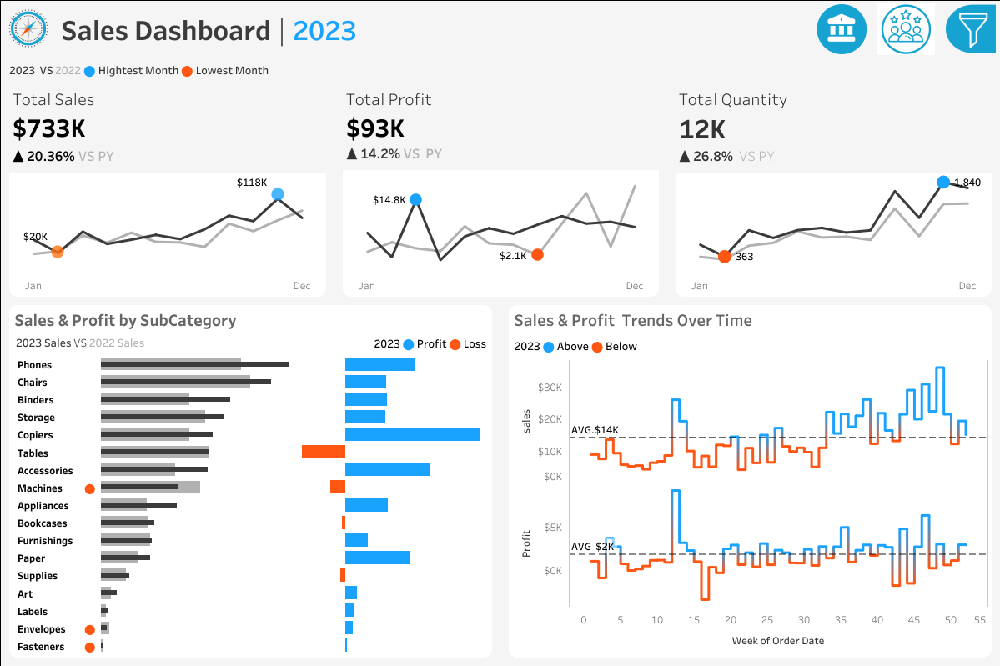
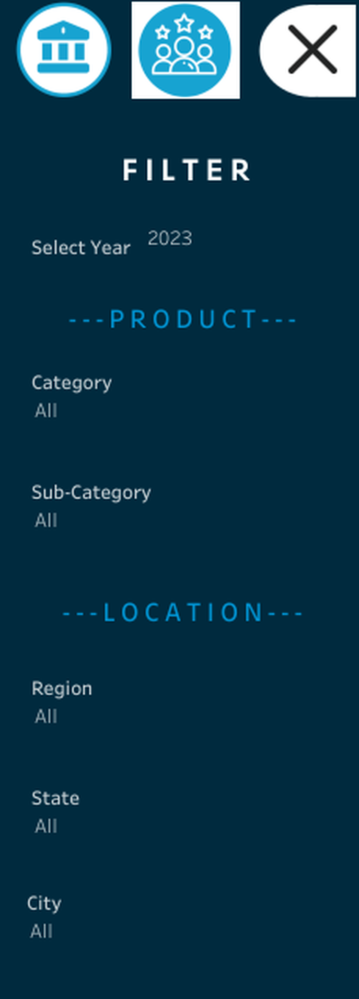
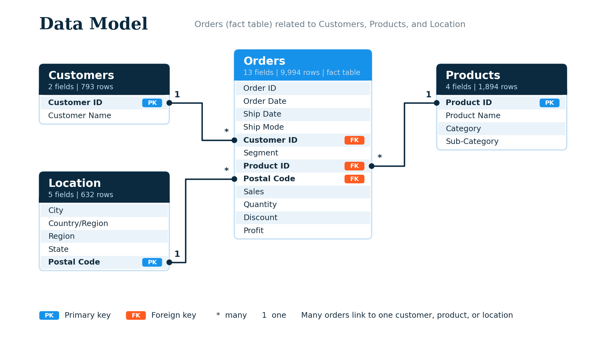

# 📊 Year-over-Year Sales & Customer Dashboard

[](https://public.tableau.com/views/ProjectDashboard2finallnih/SalesDashboard)
[](https://www.linkedin.com/in/gist-widdan-anasis-3a0a5b39a/)
[](https://github.com/widdangist999/tableau_sales_dashboard/tree/main)

An interactive Tableau dashboard that analyzes **sales performance** and **customer behavior**. The year you select is automatically compared with the previous year, so choosing 2022 compares 2022 vs 2021.

This is my **first Tableau project**.



🔗 **[View the live dashboard on Tableau Public](https://public.tableau.com/views/ProjectDashboard2finallnih/SalesDashboard)**

---

## 📑 Table of Contents

- [Dashboards](#-dashboards)
- [Key Findings](#-key-findings)
- [Interactivity](#-interactivity)
- [Data Model](#-data-model)
- [Calculated Fields](#-calculated-fields)
- [Repository Structure](#-repository-structure)
- [How to Use](#-how-to-use)
- [Tools](#-tools)
- [Credit](#-credit)
- [Author](#-author)

---

## 🧭 Dashboards

### 1. Sales Dashboard

Gives an overview of sales metrics and trends to analyze year-over-year performance.

| Component | What it shows |
|-----------|---------------|
| **KPI Overview** | Total Sales, Profit, and Quantity vs the previous year |
| **Monthly Trends** | Sparklines for each KPI, with the highest (blue) and lowest (orange) months marked |
| **Sub-Category Comparison** | Sales for the selected vs previous year, next to profit or loss |
| **Weekly Trends** | Weekly sales and profit with an average line, highlighting weeks above and below average |

### 2. Customer Dashboard

Gives an overview of customer data, trends, and behavior.

| Component | What it shows |
|-----------|---------------|
| **KPI Overview** | Total Customers, Sales per Customer, and Total Orders vs the previous year |
| **Monthly Trends** | Sparklines for each KPI, with the highest and lowest months marked |
| **Customers Distribution** | How many customers placed 1, 2, 3 ... orders |
| **Top 10 Customers by Profit** | Rank, name, last order date, profit, sales, and number of orders |


---

## 💡 Key Findings

Based on the example view of **2023 vs 2022**:

| # | Finding |
|---|---------|
| 1 | **Sales grew 20.4%** to $733K, while **profit grew only 14.2%** to $93K, so the profit margin dipped slightly. |
| 2 | **Tables** and **Machines** were unprofitable. Tables has high sales but still loses money. |
| 3 | Sales and quantity were lowest in **February** and peaked in **November**. Profit peaked in **March**. |
| 4 | **Orders grew 28.3%**, far faster than customers (8.6%), so customers are buying more often. |
| 5 | **71% of customers** (493 of 693) placed more than one order. |

---

## 🎛️ Interactivity



- **Select Year**: pick any year, and every KPI is compared with the year before
- **Product filters**: Category and Sub-Category
- **Location filters**: Region, State, and City
- **Click-to-filter**: charts can be used to filter the data
- **Navigation**: icons at the top right to switch between dashboards

---

## 🗂️ Data Model

Four related tables, with **Orders** as the main (fact) table.



| Table | Fields | Rows |
|-------|--------|------|
| Orders | 13 | 9,994 |
| Customers | 2 | 793 |
| Location | 5 | 632 |
| Products | 4 | 1,894 |

**Dataset source:** [add dataset name and link here]

---

## 🧮 Calculated Fields

The dashboard uses a **Select Year** parameter, with CY (current year) and PY (previous year) fields powering every chart. Full formulas, including `% Diff`, `MIN/MAX` markers, and the LOD expression for the orders distribution, are documented here:

👉 **[docs/calculated-fields.md](docs/calculated-fields.md)**

A quick example:

```
CY Sales = IF YEAR([Order Date]) = [Select Year] THEN [Sales] END
PY Sales = IF YEAR([Order Date]) = [Select Year] - 1 THEN [Sales] END
```

---

## 📁 Repository Structure

```
tableau_sales_dashboard/
├── README.md
├── data/
│   ├── Orders.csv
│   ├── Customers.csv
│   ├── Location.csv
│   └── Products.csv
├── workbook/
│   └── Sales_Customer_Dashboard.twbx
├── images/
│   ├── sales-dashboard.png
│   ├── customer-dashboard.png
│   ├── data-model.png
│   └── filter-panel.png
└── docs/
    ├── Project_Dashboard_Tableau_EN.pptx
    ├── Project_Dashboard_Tableau.pptx
    └── calculated-fields.md
```

---

## 🚀 How to Use

1. **Quick look:** open the [live dashboard](https://public.tableau.com/views/ProjectDashboard2finallnih/SalesDashboard) in your browser.
2. **Explore the workbook:** download `workbook/Sales_Customer_Dashboard.twbx` and open it in Tableau Public or Tableau Desktop.
3. **Understand the build:** read the [calculated fields](docs/calculated-fields.md) or browse the project slides:
   - 📄 [Presentation (English)](docs/Project_Dashboard_Tableau_EN.pptx)
   - 📄 [Presentation (Indonesian)](docs/Project_Dashboard_Tableau.pptx)

---

## 🛠️ Tools

- **Tableau Public**: dashboard design and publishing
- **CSV files**: data source (4 related tables)
- **Tableau features used**: relationships, parameters, calculated fields, LOD expressions, sparklines, dashboard actions, and filters

---

## 🙏 Credit

This project was inspired by the Tableau tutorial from [Creator Name](https://www.linkedin.com/in/creator-profile/). I followed the dashboard concept and dataset, then built and documented my own version.

---

## 👤 Author

**Gist Widdan Anasis**

- 💼 LinkedIn: [gist-widdan-anasis](https://www.linkedin.com/in/gist-widdan-anasis-3a0a5b39a/)
- 🐙 GitHub: [widdangist999](https://github.com/widdangist999)
- 📊 Tableau Public: [Live dashboard](https://public.tableau.com/views/ProjectDashboard2finallnih/SalesDashboard)

Feedback and discussion are very welcome. If you find this project useful, a ⭐ on the repo is appreciated!
